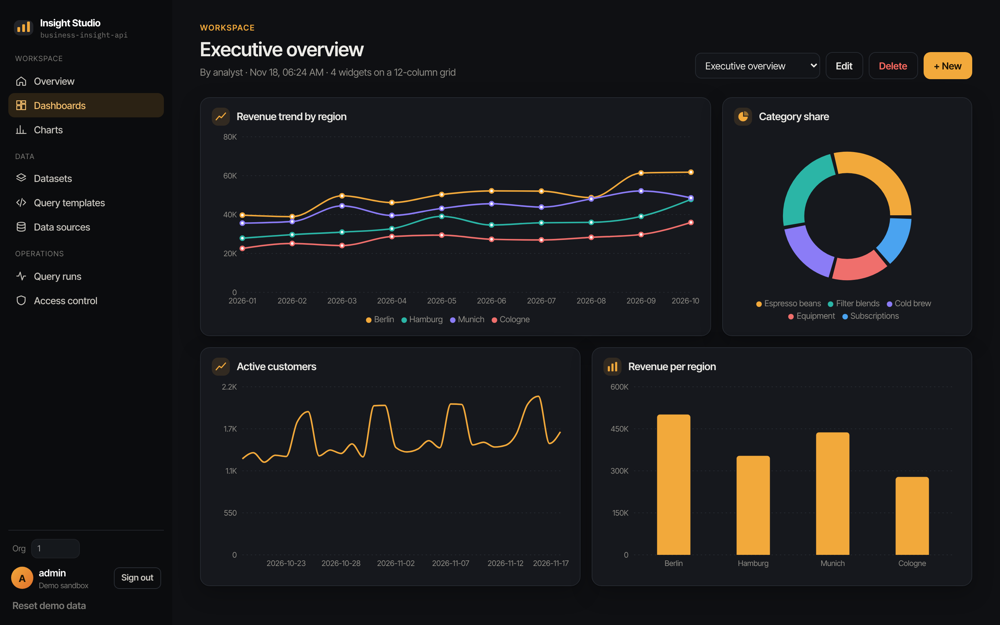
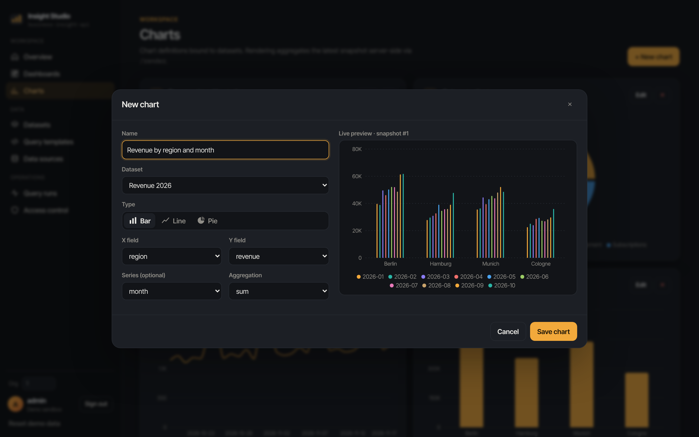

# Business Insight API

[](https://github.com/savasoyigit/business-insight-api/actions/workflows/ci.yml)
[](https://savasoyigit.github.io/business-insight-api/)

A multi-tenant BI backend (Spring Boot) with a React UI, **Insight Studio**. It runs guarded SQL against external
PostgreSQL / SQL Server databases and turns the results into charts and dashboards.

**[Try the live demo](https://savasoyigit.github.io/business-insight-api/)**: it runs fully in the browser, no backend
needed. Sign in as `admin`, `analyst` or `viewer` to see the UI change with the role.



| Query templates | Chart builder |
| --- | --- |
|  |  |

## Features

- **Multi-tenant with RBAC**: users only reach their own organizations; fine-grained permissions with an audit trail.
- **Safe SQL**: `SELECT` only, checked by a SQL parser, no functions that reach server files or other servers, and run in
  read-only transactions that are always rolled back.
- **Protected credentials**: datasource passwords are encrypted at rest and never returned.
- **Async and scheduled runs**: queued queries and cron-based dataset refresh.
- **Observability**: correlation IDs, Micrometer metrics and a Prometheus endpoint, behind their own permission.

## Setup

Requires Java 17+, Node 22+ and Docker (or any PostgreSQL).

```bash
docker compose up -d                                   # PostgreSQL on :5432
export JWT_SECRET=$(openssl rand -base64 48)
export APP_SECRETS_KEY=$(openssl rand -base64 32)      # encrypts datasource passwords; keep it safe
export ADMIN_PASSWORD='choose-a-strong-one'
export INSIGHT_ALLOW_LOOPBACK=true                     # local development only: allow datasources on localhost
./mvnw spring-boot:run                                 # API on http://localhost:8080

cd frontend && npm install && npm run dev              # UI on http://localhost:5173
```

Sign in as `admin` with your `ADMIN_PASSWORD`. For production, run with `SPRING_PROFILES_ACTIVE=prod`, and behind a
reverse proxy set `SERVER_FORWARD_HEADERS_STRATEGY=native`. Metrics need the `OPS_METRICS_ACCESS` permission; a
Prometheus scraper can use `METRICS_SCRAPE_TOKEN` as its bearer token instead. All other settings are in
[`application.yml`](src/main/resources/application.yml).

## Usage

1. **Add a data source**: a PostgreSQL or SQL Server connection. Enter the password (stored encrypted) or reference
   an environment variable such as `env:DS_SECRET_ERP`. Use a read-only database login.
2. **Write a query template**: a `SELECT` with named parameters, e.g. `where order_date >= :startDate`.
3. **Create a dataset**: the template plus parameter values, optionally refreshed on a schedule (`0 6 * * *`).
4. **Build charts** (bar, line, pie) from the dataset and arrange them on a **dashboard**.

The same flow is available over the REST API under `/api/insight/**`; see the
[Postman collection](postman/business-insight-api.postman_collection.json).

## Tests

```bash
DS_SECRET_TEST_DB=app ./mvnw verify   # needs a PostgreSQL database named businessinsight_test
```

CI runs the tests against PostgreSQL and builds the frontend on every push and pull request. Pushes to `master` that
touch `frontend/` redeploy the live demo to GitHub Pages.
