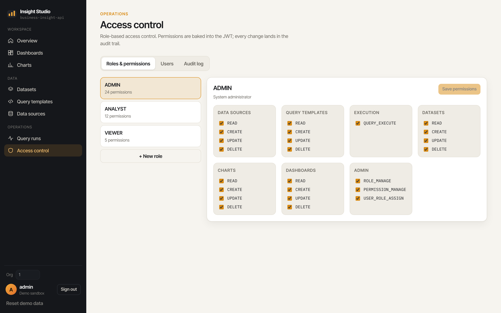
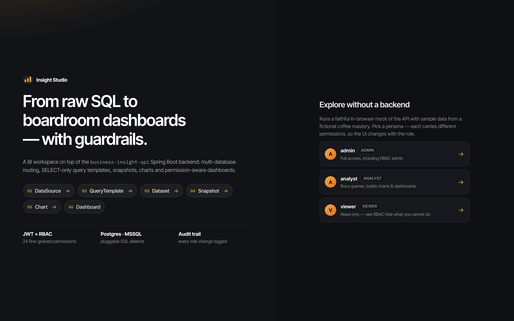

# Business Insight API

[](https://savasoyigit.github.io/business-insight-api/)
[](https://github.com/savasoyigit/business-insight-api/actions/workflows/ci.yml)
[](https://github.com/savasoyigit/business-insight-api/actions/workflows/deploy-demo.yml)

Spring Boot backend for external datasource routing, SQL-based insight execution, and BI asset management,
with **Insight Studio**, a React web UI on top of it.

It supports this flow:

`DataSource -> QueryTemplate -> Dataset -> Snapshot -> Chart -> Dashboard`

**Try it:** https://savasoyigit.github.io/business-insight-api/ runs fully in the browser with sample data, no backend needed.


## Frontend: Insight Studio

A React + TypeScript web UI in [`frontend/`](frontend/README.md) that covers the whole flow,
query-run history and RBAC administration.

| Query templates | Chart builder |
| --- | --- |
|  |  |

| Access control | Sign in |
| --- | --- |
|  |  |

Features:

- **Data sources**: create and edit Postgres / SQL Server connections, then test them with one click.
- **Query workbench**: highlighted SQL with `:named` params, a live guardrail preview, typed parameter inputs, validate and execute.
- **Datasets and snapshots**: take snapshots with parameter overrides and browse the stored rows.
- **Chart builder**: bar, line and pie charts with a live preview. Field pickers come from the latest snapshot,
  and the preview uses the same aggregation as `ChartService.render` (sum / avg / count, optional series).
- **Dashboards**: widgets on a 12-column grid driven by the stored `{x, y, w, h}` layouts, plus a layout editor.
- **Operations**: query-run history (status, duration, row count, query hash) and RBAC admin
  (roles and permissions matrix, user roles, audit log).
- **Permission-aware**: reads the JWT `perms` claim and hides navigation, pages and actions the role cannot use.
- Light and dark themes (follows the OS), responsive down to phone width.

### Demo sandbox

The UI ships an in-browser mock of the API that mirrors its behavior: SQL guardrails, named params,
RBAC and org scoping. It is seeded with data from a fictional coffee roastery. On the sign-in page, choose a persona:

| Persona | Role | What it shows |
| --- | --- | --- |
| `admin` | ADMIN | Everything, including access control |
| `analyst` | ANALYST | Runs queries and builds datasets, charts and dashboards |
| `viewer` | VIEWER | Read-only; create and edit actions disappear |

Changes made in the demo stay in the visitor's browser. **Reset demo data** in the sidebar restores the sample data.

### Run the frontend

```bash
cd frontend
npm install
npm run dev          # http://localhost:5173, /api is proxied to http://localhost:8080
npm run build        # production build against the API
npm run build:demo   # static build that only offers the demo sandbox
```

Sign in with the seeded admin (`ADMIN_USERNAME` / `ADMIN_PASSWORD`, defaults `admin` / `ChangeMe_DevOnly_123456!`).
If the frontend is served from a different origin than the API, set `VITE_API_BASE_URL` (see `frontend/.env.example`)
and add that origin to `CORS_ALLOWED_ORIGINS` on the API.

### Deployment

[`.github/workflows/deploy-demo.yml`](.github/workflows/deploy-demo.yml) builds the demo sandbox and publishes it to
GitHub Pages on every push to `master` that touches `frontend/`. It can also be started by hand from the Actions tab.
Pages must be enabled once under **Settings → Pages → Source: GitHub Actions**.

## Stack

- Java 17
- Spring Boot
- Spring Boot Actuator (Micrometer metrics)
- Spring Security with JWT
- PostgreSQL
- Flyway
- Maven
- Frontend: React 18, TypeScript, Vite, Recharts

## Project Structure

- `api`: REST controllers and DTOs
- `application`: business services and orchestration
- `domain`: JPA entities and repositories
- `infrastructure`: security, bootstrap, config
- `common`: shared error handling
- `frontend/`: Insight Studio web UI (see [frontend/README.md](frontend/README.md))
- `.github/workflows/`: CI (tests + frontend build) and GitHub Pages deployment of the demo

## Core Concepts

### DataSource

Represents an external database connection definition.

Example:

```json
{
  "name": "Reporting Postgres",
  "type": "POSTGRES",
  "host": "localhost",
  "port": 5432,
  "databaseName": "erp_reporting",
  "username": "readonly_user",
  "secretRef": "env:ERP_REPORTING_PASSWORD",
  "options": {
    "ssl": false
  }
}
```

Passwords are never stored in plaintext and never returned by the API. There are two ways to provide one:

| Request field | Stored as | Notes |
| --- | --- | --- |
| `"password": "..."` | `enc:v1:<base64>` (AES-256-GCM) | Needs `APP_SECRETS_KEY` on the server. Write-only; responses show `"secretType": "ENCRYPTED"` and `"secretRef": null`. |
| `"secretRef": "env:VAR_NAME"` | the reference itself | The password is read from the API server's environment at query time. |

Send exactly one of them. On update, sending neither keeps the current secret. Clients cannot send `enc:` values directly.

Generate the encryption key once and keep it safe; losing it means re-entering the encrypted passwords:

```bash
export APP_SECRETS_KEY=$(openssl rand -base64 32)
```

**Multi-database support**: Postgres and MSSQL connectors with pluggable SQL dialect architecture.

**Supported Database Types:**
- `POSTGRES` - PostgreSQL databases
- `MSSQL` - Microsoft SQL Server databases

**Testing Connections:**

Use the connection test endpoint to verify datasource connectivity:

```http
POST /api/insight/data-sources/{id}/test?orgId={orgId}
```

Response:
```json
{
  "ok": true,
  "latencyMs": 45,
  "error": null
}
```

### QueryTemplate

Parameterized, guarded SQL definition bound to a datasource.

Guardrails, in layers:

1. **Keyword checks** (dialect-aware): must start with `SELECT`; `;`, DDL/DML keywords and dynamic identifiers
   (`${...}`, `{{...}}`) are rejected.
2. **Parser** ([JSqlParser](https://github.com/JSQLParser/JSqlParser), `SqlStatementGuard`): the text must parse as exactly one
   SELECT. `SELECT ... INTO` (which creates a table), locking clauses (`FOR UPDATE/SHARE`) and data-modifying `WITH`
   items are rejected. SQL Server `[bracketed]` identifiers are understood for MSSQL sources.
3. **Database**: every query runs on its own connection in a read-only transaction that is always rolled back.
   - **PostgreSQL** enforces it (`SET TRANSACTION READ ONLY`): even a SELECT that writes, such as `select nextval(...)`, fails.
     A `statement_timeout` matching the query timeout is set too.
   - **SQL Server** has no read-only transaction mode, so nothing is ever committed (rollback) and `LOCK_TIMEOUT` is set.
     Use a login with read-only rights (for example `db_datareader`) for real protection.

The connection test runs through the same read-only setup. Further limits:

- named parameters supported via `:paramName`
- unexpected params rejected
- default row cap: `5000` (applied via `LIMIT` or `TOP` depending on database type)
- snapshot row cap: `500`
- JDBC timeout: `30s`

Example:

```json
{
  "dataSourceId": 1,
  "name": "Current Date Validation",
  "description": "Execution routing smoke test",
  "sqlText": "select current_date as run_date where current_date >= :startDate",
  "parameters": [
    { "name": "startDate", "type": "date", "required": true }
  ],
  "outputSchema": [
    { "name": "run_date", "type": "date" }
  ]
}
```

### Dataset

Represents a reusable BI dataset built on top of a query template.

Contains:

- `queryTemplateId`
- `defaultParams`
- `createdBy`

Example:

```json
{
  "name": "Sales Daily",
  "queryTemplateId": 1,
  "defaultParams": {
    "startDate": "2026-01-01"
  }
}
```

### Snapshot

Materialized dataset result stored in `dataset_snapshot`.

- linked to `query_run`
- optionally linked to `dataset`
- stored as JSON for MVP

### Chart

Chart metadata bound to a dataset.

Supported chart types:

- `BAR`
- `LINE`
- `PIE`

Config example:

```json
{
  "xField": "run_date",
  "yField": "amount",
  "seriesField": "region",
  "aggregation": "sum"
}
```

Render endpoint reads a snapshot and returns chart-ready points.

### Dashboard

Dashboard contains widgets referencing charts plus a JSON layout.

Layout example:

```json
{
  "x": 0,
  "y": 0,
  "w": 6,
  "h": 4
}
```

## Security

All endpoints except `/api/auth/**` require authentication.

### Organizations (tenant isolation)

Every BI asset belongs to an organization, and users only reach the organizations they are members of.

- Memberships are stored in `organization_member` and travel in the JWT `orgs` claim, next to `perms`.
- Every `/api/insight/**` request must carry `?orgId=`. `OrganizationAccessInterceptor` checks it centrally,
  so a new endpoint cannot skip the check:
  - missing or non-numeric `orgId` returns `400`
  - an organization the caller is not a member of returns `403`
- Admins manage organizations and memberships with the `RBAC_ORG_MANAGE` permission. The creator of an organization
  becomes its first member, and every membership change is audited.
- Like permissions, membership changes take effect on the user's next sign-in.
- `GET /api/me` returns the caller's username, permissions and organizations.
- Upgrade note: migration `V8` makes existing users members of all existing organizations, so nothing breaks
  on upgrade. Narrow memberships afterwards via `PUT /api/admin/rbac/users/{id}/organizations`.

Method security is enabled with `@EnableMethodSecurity`.

Main permission groups:

- datasource: `INSIGHT_DS_*`
- query template: `INSIGHT_QT_*`
- query execution: `INSIGHT_QUERY_EXECUTE`
- dataset: `INSIGHT_DATASET_*`
- chart: `INSIGHT_CHART_*`
- dashboard: `INSIGHT_DASHBOARD_*`
- admin RBAC: `RBAC_*` (organizations: `RBAC_ORG_MANAGE`)

Phase 5 hardening:

- login rate limiting (per user and IP window)
- account lockout after repeated failed login attempts
- password policy enforcement on registration
- RBAC admin audit logs for role and assignment changes
- SQL safety checks block dynamic identifier templates (for example `${...}` and `{{...}}`)

CORS:

- Enabled for `/api/**` so a browser frontend on another origin can call the API.
- Allowed origins come from `CORS_ALLOWED_ORIGINS` (comma-separated, default `http://localhost:5173`).
  Requests from other origins are rejected.

## Error Handling

All errors use the same JSON shape (`timestamp`, `status`, `error`, `message`, `path`).

| Status | When |
| --- | --- |
| `400` | Validation errors, `BadRequestException`, malformed request bodies, missing or invalid parameters |
| `401` | Missing, malformed or expired token; invalid credentials; locked account |
| `403` | Authenticated, but missing the required permission or membership of the requested organization |
| `409` | Unique constraint violations, such as a duplicate name within an organization or a taken username |
| `429` | Login rate limit exceeded |
| `500` | Unexpected errors. The response stays generic, and the full exception is logged with the request's correlation ID. |

## JSON Fields and Jackson

Spring Boot 4 reads and writes HTTP bodies with Jackson 3 (`tools.jackson`), while the domain and DTOs keep
free-form JSON in Jackson 2's `JsonNode` (datasource `options`, template `parameters` / `outputSchema`,
dataset `defaultParams`, chart `config`, widget `layout`, audit `details`).
`LegacyJsonNodeModuleConfig` registers a Jackson 3 module that passes these trees through unchanged in both
directions, so JSON objects in those fields work over HTTP.

## Observability

- Correlation ID support via `X-Correlation-Id` request/response header
- Log correlation with `correlationId` in log context
- Query execution metrics and timings via Micrometer
- Actuator endpoints exposed:
  - `/actuator/health`
  - `/actuator/info`
  - `/actuator/metrics`
  - `/actuator/prometheus`

## Main Endpoints

### DataSource

- `GET /api/insight/data-sources`
- `GET /api/insight/data-sources/{id}`
- `POST /api/insight/data-sources`
- `PUT /api/insight/data-sources/{id}`
- `POST /api/insight/data-sources/{id}/test` - Test database connectivity

### Query Execution

- `POST /api/insight/query-execution/validate`
- `POST /api/insight/query-execution/execute`
- `GET /api/insight/query-execution/runs` (paged)

### Dataset

- `GET /api/insight/datasets`
- `GET /api/insight/datasets/{id}`
- `POST /api/insight/datasets`
- `PUT /api/insight/datasets/{id}`
- `DELETE /api/insight/datasets/{id}`
- `GET /api/insight/datasets/{id}/snapshots` (paged)
- `POST /api/insight/datasets/{id}/snapshots`

### RBAC Admin

- `GET /api/admin/rbac/permissions`
- `GET /api/admin/rbac/roles`
- `POST /api/admin/rbac/roles`
- `PUT /api/admin/rbac/roles/{id}`
- `PUT /api/admin/rbac/roles/{id}/permissions`
- `GET /api/admin/rbac/users`
- `PUT /api/admin/rbac/users/{id}/roles`
- `GET /api/admin/rbac/organizations`
- `POST /api/admin/rbac/organizations`
- `PUT /api/admin/rbac/users/{id}/organizations`
- `GET /api/admin/rbac/audit-logs` (paged)

### Chart

- `GET /api/insight/charts`
- `GET /api/insight/charts/{id}`
- `POST /api/insight/charts`
- `PUT /api/insight/charts/{id}`
- `DELETE /api/insight/charts/{id}`
- `GET /api/insight/charts/{id}/render?snapshotId=...`

### Dashboard

- `GET /api/insight/dashboards`
- `GET /api/insight/dashboards/{id}`
- `POST /api/insight/dashboards`
- `PUT /api/insight/dashboards/{id}`
- `DELETE /api/insight/dashboards/{id}`

## Running Locally

### 1. Start PostgreSQL

```bash
docker compose up -d
```

### 2. Set required environment variables

Windows PowerShell:

```powershell
$env:JWT_SECRET="your_long_random_secret_here"
$env:ERP_REPORTING_PASSWORD="your_readonly_password"
```

Linux/macOS:

```bash
export JWT_SECRET=your_long_random_secret_here
export ERP_REPORTING_PASSWORD=your_readonly_password
```

Optional:

| Variable | Purpose |
| --- | --- |
| `APP_SECRETS_KEY` | Base64 32-byte key (`openssl rand -base64 32`) that enables encrypted datasource passwords |
| `ADMIN_USERNAME`, `ADMIN_EMAIL`, `ADMIN_PASSWORD` | Seeded admin account. Set `ADMIN_PASSWORD` before the first start. |
| `CORS_ALLOWED_ORIGINS` | Comma-separated browser origins allowed to call the API directly (default `http://localhost:5173`) |
| `SPRING_PROFILES_ACTIVE=prod` | Production profile: refuses to start while the admin still has the default password |

Without `ADMIN_PASSWORD` the admin gets a development default and a warning is logged on every start.
With the `prod` profile the application refuses to start in that state.

### 3. Run the application

```bash
./mvnw spring-boot:run
```

Base URL:

```text
http://localhost:8080
```

### 4. Start the frontend (optional)

```bash
cd frontend && npm install && npm run dev
```

Open http://localhost:5173.

## Postman Collection

Collection path:

`postman/business-insight-api.postman_collection.json`

Current folders:

- `Auth`
- `Insight / Execution`
- `Insight / BI Assets`
- `RBAC Admin`

Recommended execution order in Postman:

1. Login
2. Create Data Source
3. Create Query Template
4. Validate Query Execution
5. Create Dataset
6. Create Dataset Snapshot
7. List Query Runs (paged)
8. Create Chart
9. Render Chart
10. Create Dashboard
11. RBAC audit logs (admin)

## Example BI Flow

1. Data engineer creates a datasource.
2. Data engineer creates a query template.
3. Product or analytics user creates a dataset on top of that template.
4. Dataset snapshot is generated.
5. Chart is created against the dataset.
6. Dashboard is created with one or more chart widgets.

### Current User

- `GET /api/me`: username, permissions and organizations of the caller

## Tests

Integration tests boot the full application (security filter chain included) against a real PostgreSQL database.
They cover authentication and status codes, tenant isolation, RBAC, membership administration and auditing,
JSON fields, SQL guardrails, encrypted passwords, read-only enforcement in the database, and the whole pipeline
from data source to rendered chart and dashboard. Unit tests cover the SQL parser guard and the secret cipher.

```bash
# a database for tests (any PostgreSQL works; defaults shown)
createdb businessinsight_test

export TEST_DB_URL=jdbc:postgresql://localhost:5432/businessinsight_test   # default
export TEST_DB_USER=app                                                    # default
export TEST_DB_PASSWORD=app   # also enables the live pipeline test (env:TEST_DB_PASSWORD)

./mvnw verify
```

The live pipeline test uses the test database itself as the external data source and is skipped when
`TEST_DB_PASSWORD` is not set.

CI ([`.github/workflows/ci.yml`](.github/workflows/ci.yml)) runs these tests on every push and pull request,
using a PostgreSQL service container, and also builds the frontend.

## Build Check

Compile locally with:

```bash
./mvnw -q -DskipTests compile
```
