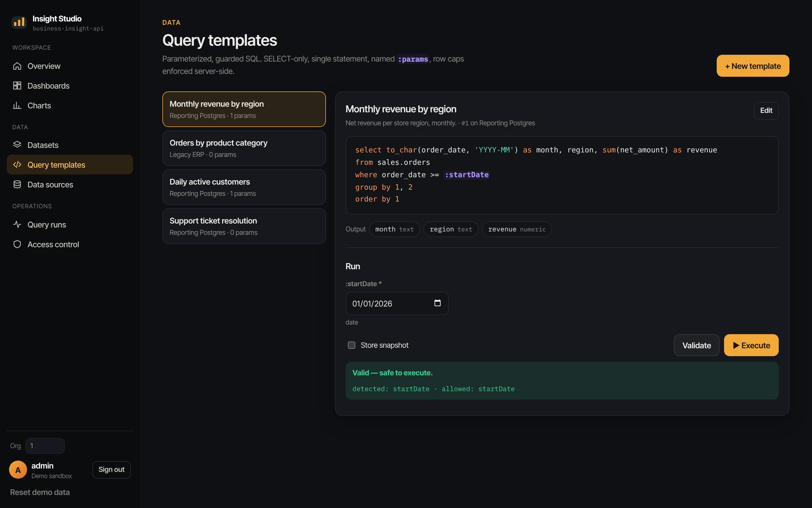

# Business Insight API

[](https://github.com/savasoyigit/business-insight-api/actions/workflows/ci.yml)
[](https://savasoyigit.github.io/business-insight-api/)

A multi-tenant BI backend (Spring Boot) with a React UI, **Insight Studio**. It runs guarded SQL against external
PostgreSQL / SQL Server databases and turns the results into snapshots, charts and dashboards:

`DataSource → QueryTemplate → Dataset → Snapshot → Chart → Dashboard`

**[Try the live demo](https://savasoyigit.github.io/business-insight-api/)**: it runs fully in the browser, no backend needed.
Sign in as `admin`, `analyst` or `viewer` to see the UI change with the role.


| Query templates | Chart builder |
| --- | --- |
|  |  |

## Highlights

- **Multi-tenant**: users only reach organizations they belong to, enforced centrally on every request.
- **RBAC**: 25 fine-grained permissions carried in the JWT, with an audit trail for every role and membership change.
- **Layered SQL safety**: keyword checks, a SQL parser, and read-only, always-rolled-back transactions in the target database.
- **Secrets**: datasource passwords are encrypted at rest (AES-256-GCM) or referenced from the environment, and never returned.
- **Async and scheduled**: queued runs with polling, cron-based dataset refresh, snapshot retention and crash recovery.
- **Observability**: correlation IDs, Micrometer metrics, Actuator / Prometheus endpoints.
- **Tested**: 41 integration and unit tests against a real PostgreSQL, run in CI.

## Quick start

```bash
docker compose up -d                                   # PostgreSQL on :5432
export JWT_SECRET=$(openssl rand -base64 48)
export APP_SECRETS_KEY=$(openssl rand -base64 32)      # enables encrypted datasource passwords
export ADMIN_PASSWORD='choose-a-strong-one'
./mvnw spring-boot:run                                 # API on http://localhost:8080

cd frontend && npm install && npm run dev              # UI on http://localhost:5173
```

Sign in with `admin` and your `ADMIN_PASSWORD`. Without `ADMIN_PASSWORD`, a development default is used and a warning
is logged on every start.

### Configuration

| Variable | Purpose |
| --- | --- |
| `JWT_SECRET` | **Required.** At least 32 characters. |
| `APP_SECRETS_KEY` | Base64 32-byte key for encrypted datasource passwords. Keep it safe; losing it means re-entering those passwords. |
| `ADMIN_USERNAME`, `ADMIN_EMAIL`, `ADMIN_PASSWORD` | The seeded admin account. |
| `CORS_ALLOWED_ORIGINS` | Browser origins allowed to call the API directly (default `http://localhost:5173`). |
| `INSIGHT_SCHEDULER_ZONE` | Time zone for dataset refresh schedules (default `UTC`). |
| `SPRING_PROFILES_ACTIVE=prod` | Refuses to start while the admin still has the default password. |

Execution limits (row caps, timeouts, worker pool, snapshot retention) are in `application.yml` under `app.insight`.

## How it works

| Concept | What it is |
| --- | --- |
| **DataSource** | An external PostgreSQL or SQL Server connection. Its password is sent once as `password` (stored encrypted) or given as `secretRef: env:VAR`. |
| **QueryTemplate** | A guarded `SELECT` with named `:params`, bound to a data source. |
| **Dataset** | A template plus default parameters, with an optional refresh schedule (cron such as `0 6 * * *` or `@hourly`). |
| **Snapshot** | Up to 500 materialized rows of a run. The newest 50 per dataset are kept. Dashboards read snapshots, never live queries. |
| **Chart** | `BAR`, `LINE` or `PIE` over a dataset: `xField`, `yField`, optional `seriesField`, aggregation `sum` / `avg` / `count`. |
| **Dashboard** | Chart widgets on a 12-column grid (`{x, y, w, h}`). |

Queries run synchronously (`POST /query-execution/execute`) or asynchronously: `POST /query-execution/jobs` returns
`202` with a run id, which clients poll at `GET /query-execution/runs/{id}`. Identical submissions that are still in
flight share one run. A full worker queue returns `429`. Runs left unfinished by a restart are marked `INTERRUPTED`.

## Security model

- **Authentication**: JWT carrying the `perms` and `orgs` claims. Login is rate limited, accounts lock after repeated
  failures, and a password policy applies on registration.
- **Tenant isolation**: every `/api/insight/**` call needs `?orgId=`, and the caller must be a member of that
  organization (`403` otherwise). Admins manage organizations and memberships. Changes apply at the next sign-in.
- **SQL guardrails**, in layers:
  1. Keyword checks: `SELECT` only, a single statement, no DDL/DML, no dynamic identifiers.
  2. A [JSqlParser](https://github.com/JSQLParser/JSqlParser) check: exactly one plain `SELECT`, with no `INTO`,
     `FOR UPDATE` or data-modifying `WITH`.
  3. Every query runs in a read-only transaction that is always rolled back. PostgreSQL enforces it, so even a
     `SELECT` with side effects fails, and a `statement_timeout` applies. SQL Server has no read-only mode, so give
     its data sources a read-only login (`db_datareader`).
- **Secrets**: passwords are encrypted (`enc:v1:`) or referenced from the environment. Responses only report
  `secretType`.
- **Errors** share one JSON shape:
  - `400` invalid input
  - `401` unauthenticated
  - `403` missing permission or membership
  - `409` duplicate
  - `429` throttled
  - `500` unexpected, with details only in the logs (correlation ID)

## API overview

| Area | Base path | Notes |
| --- | --- | --- |
| Auth | `/api/auth/login`, `/api/auth/register`, `/api/me` | `/api/me` returns permissions and organizations. |
| Data sources | `/api/insight/data-sources` | CRUD, plus `POST /{id}/test` |
| Query templates | `/api/insight/query-templates` | CRUD |
| Execution | `/api/insight/query-execution` | `validate`, `execute`, `jobs`, `runs`, `runs/{id}` |
| Datasets | `/api/insight/datasets` | CRUD, `snapshots` (sync), `snapshot-jobs` (async) |
| Charts | `/api/insight/charts` | CRUD, plus `GET /{id}/render?snapshotId=` |
| Dashboards | `/api/insight/dashboards` | CRUD |
| Admin | `/api/admin/rbac` | roles, permissions, users, organizations, audit logs |
| Ops | `/api/health`, `/actuator/{health,info,metrics,prometheus}` | |

List endpoints are paged (`?page=&size=&sort=`). A Postman collection with the core flow is in
[`postman/`](postman/business-insight-api.postman_collection.json).

## Project layout

```
src/main/java/.../  api (controllers, DTOs) · application (services) · domain (entities, repositories)
                    infrastructure (security, config, bootstrap) · common (errors)
src/main/resources/ application.yml · db/migration (Flyway V1–V10)
frontend/           Insight Studio: React 18, TypeScript, Vite, Recharts (see frontend/README.md)
.github/workflows/  CI (tests + frontend build) · demo deployment to GitHub Pages
```

Stack: Java 17, Spring Boot 4, Spring Security, JPA / Flyway, PostgreSQL, JSqlParser, Micrometer; React 18 for the UI.

## Tests and CI

Integration tests boot the full application, including the security filter chain, against a real PostgreSQL. They cover:

- authentication, tenancy and RBAC
- the SQL guardrails, including database-level read-only enforcement
- encrypted secrets
- async runs, scheduling and snapshot retention
- the whole pipeline, from data source to rendered dashboard

```bash
createdb businessinsight_test        # or any PostgreSQL; see src/test/resources/application-test.yml
TEST_DB_PASSWORD=app ./mvnw verify   # TEST_DB_PASSWORD also enables the live-execution tests
```

CI runs the same suite with a PostgreSQL service container, and builds the frontend, on every push and pull request.
Every push to `master` that touches `frontend/` redeploys the demo to GitHub Pages
(enable once: *Settings → Pages → Source: GitHub Actions*).
